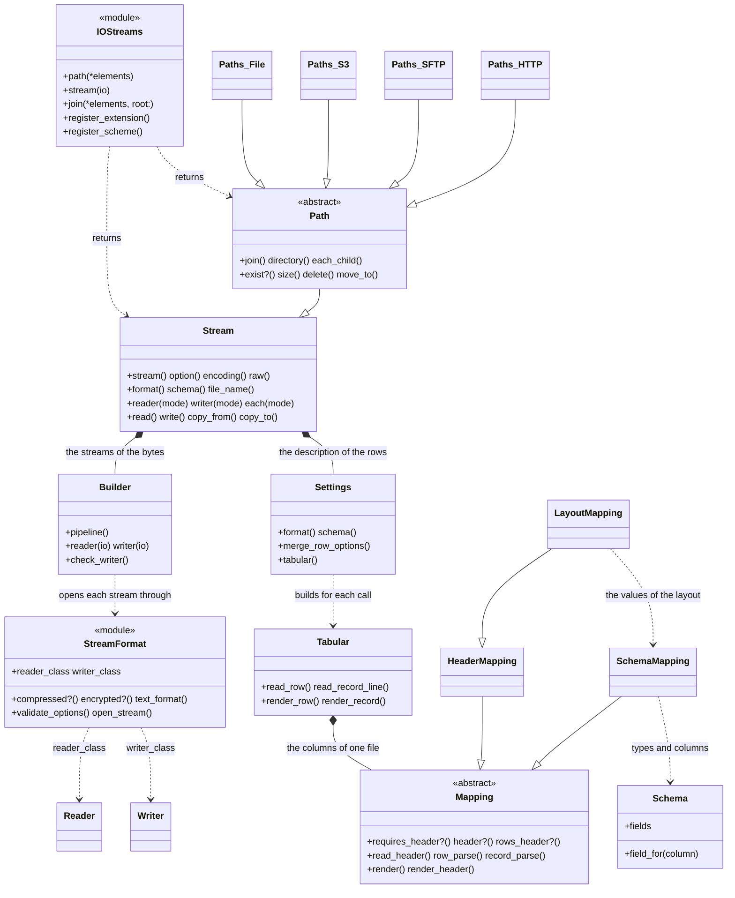

# Contributing

Welcome to IOStreams, great to have you on board. :tada:

Here are some pointers to get you started.

## Open Source

IOStreams is open source software, maintained by the author and contributors in their spare time, around the demands
of full-time jobs and other commitments. We genuinely appreciate everyone who uses the library and takes the time to
report issues or suggest improvements.

That said, please keep in mind that we may not be able to prioritize building features for a specific edge case you
have encountered, particularly one that arises in a commercial setting. This is exactly what Pull Requests are for: if
you need a particular enhancement, we warmly encourage you to contribute it yourself, and we will gladly review it and
help get it merged.

## Documentation

Documentation updates are welcome and appreciated by all users of IOStreams. The documentation is a Jekyll site under
`docs/`, published to [iostreams.reidmorrison.com](https://iostreams.reidmorrison.com). Each page is a markdown file
in `docs/`, whose title is set in its front matter.

#### Small changes

For a quick documentation fix, the change can be made entirely on GitHub:

1. Fork the repository on GitHub.
2. Open the markdown file of the page under `docs/`, such as `docs/path.md` for the Paths page.
3. Click Edit, make the change, and preview it.
4. Commit the change, and submit a Pull Request back to the IOStreams repository.

#### Complete setup

To make several changes, add pages, or preview the site locally:

1. Fork the repository on GitHub, and clone it to your machine.
2. Install the gems of the documentation site, and start Jekyll:

       cd iostreams/docs
       bundle install
       bundle exec jekyll serve

3. Open http://127.0.0.1:4000, and edit the `.md` files: each page reloads with the change.

Notes:
* The look and feel of the site comes from the shared `rm-docs-theme`, not from this repository, so do not add
  layouts or stylesheets to `docs/`.
* A new page also needs an entry in the `nav` block of `docs/_config.yml` and in `docs/llms.txt`.
* After changing any page, regenerate `docs/llms-full.txt`, the whole site in one file for AI assistants, with
  `bundle exec rake llms_full`, and commit it with the change.
* Examples should run as they are shown, with the output of the current Ruby.

## Code Changes

1. Fork the repository on GitHub, and clone it to your machine.
2. Install the gems:

       cd iostreams
       bundle install

3. Run the tests:

       bundle exec rake

   The tests need the `gpg` program of GnuPG, since they create PGP keys of their own, in `tmp/gnupg`. The S3 tests run
   against a stub unless `S3_BUCKET_NAME` is set, and the SFTP tests that need a server skip unless `SFTP_HOSTNAME`,
   `SFTP_USERNAME` and `SFTP_PASSWORD` are set. On JRuby, the tests first download the zstd-jni jar.

4. Run RuboCop:

       bundle exec rubocop

5. When fixing a bug, write a test that fails first, and only then fix the code. Make sure the test really fails
   without the fix.
6. Add an entry to `CHANGELOG.md` for any change that a user of IOStreams can notice. A change in behavior that
   existing code may depend on goes under "Breaking", with a section in `docs/upgrading.md` that says how to keep the
   previous behavior, or what to change.
7. Commit the changes, push them to your fork, and submit a Pull Request back to the IOStreams repository.

## Philosophy

IOStreams can be used to work with a single stream, but its real capability becomes apparent when it chains several
streams together to process data, without loading whole files into memory.

#### Linux Pipes

Linux streams data between programs with the `|` (pipe) operator, which sends the output of one program to the input
of the next. For example, to count the lines in a compressed file:

    gunzip -c hello.csv.gz | wc -l

`gunzip` writes the decompressed data to its standard output, which is piped into the standard input of `wc -l`, which
counts the lines. As each block of data is decompressed, it is immediately passed to `wc`, so that it can start
counting, without waiting until the whole file is decompressed, and without writing the decompressed data to disk or
holding it in memory. So very large files can be processed with very little memory.

#### Push Model

In the example above, each program pushes its output to the input of the next. The challenge with a push model is
that the programs run at different speeds, so the output of each one has to be buffered, or blocked to slow it down,
to keep the memory that it uses low.

#### Pull Model

In a pull model, the last task pulls a block from the task before it whenever it is ready to process it, so each task
only does work when the next one needs it.

#### IOStreams

IOStreams uses the pull model when reading data: each stream reads from the stream before it when it needs more data.
When writing, IOStreams uses the push model: each block that is written is pushed through every stream to the last one
before the write returns, which avoids buffering between the streams.

For example, `gunzip -c hello.csv.gz | wc -l` in Ruby, where each line is read as the file is decompressed:

~~~ruby
line_count = 0
IOStreams.path("hello.csv.gz").each { line_count += 1 }
puts "hello.csv.gz contains #{line_count} lines"
~~~

IOStreams chains the streams that the file name implies: it reads the file, decompresses it with gzip, decodes the
text as UTF-8, and splits it into lines. Any number of streams can be chained. For example, to count the word `apple`
in a file, converting its text to ASCII and removing the characters that are not printable:

~~~ruby
apple_count = 0
IOStreams.path("hello.csv.gz").
  encoding("US-ASCII", replace: "", cleaner: :printable).
  each { |line| apple_count += line.scan("apple").count }
puts "Found the word 'apple' #{apple_count} times in hello.csv.gz"
~~~

Whatever the size of the file, only a block of it is in memory at any time.

## Architecture

### Public vs internal API

The `IOStreams` module is the public interface, and everyone using IOStreams starts there, typically with
`IOStreams.path`, `IOStreams.stream` or `IOStreams.join`. Once one of those returns a path or a stream, the methods of
that object are part of the public interface too, as are the names and values of the options set with `#option`,
`#stream` and `#encoding`, the schema set with `#schema`, and the documented `IOStreams::Pgp` methods.

Everything else is internal. No one should create a path class directly, or call the reader and writer classes of a
format, such as `IOStreams::Zip::Writer.stream`. This keeps the API small for everyone using IOStreams, and lets the
internals change without breaking existing code. [Extending IOStreams](https://iostreams.reidmorrison.com/extending)
documents the interfaces for registering a format or a storage scheme of your own.

The public interface must remain backward compatible: evolve it by adding new methods, options and values, never by
removing or changing the meaning of what applications may depend on. A deliberate change in behavior is documented
under "Breaking" in the CHANGELOG, and in `docs/upgrading.md`.

### Components

Each component is responsible for its own data and behavior, and asks the others for what it needs, rather than
knowing their internals:

* **`Stream`**, and its subclass **`Path`**, are what the application holds: the settings that describe the file, and
  the methods that read and write it. Each storage scheme, such as `Paths::S3`, implements the operations of its store,
  and how it reads and writes the bytes of a file.
* **`Builder`** holds the streams of the bytes: those that the file name implies, those set with `#stream` and
  `#option`, and the built-in encode stream, which converts the text that the application reads and writes. It asks
  the format of each stream to open its reader or writer, in order.
* **A format**, such as `IOStreams::Gzip`, is a module that extends `IOStreams::StreamFormat`. It answers the facts
  about its data, such as whether it is compressed, and opens its `Reader` and `Writer` classes with the options that
  each one takes. `IOStreams.register_extension` registers a format for a file name extension.
* **A `Reader` or `Writer`** of a format reads or writes one stream: `.stream(io)` yields an object that reads like an
  IO, by including `IOStreams::ChunkReader`, or writes like one, by including `IOStreams::Writable`, whichever format
  it is, so that the code that reads a `.gz` file still works when the file name changes to `.bz2`. The base classes
  copy the data to a temp file for a format that only reads or writes files, such as zip.
* **`Tabular::Settings`** holds the settings that describe the rows of a stream: its format, its schema, and the
  options of the rows of a format such as Parquet. It checks each one when it is set, and builds the `Tabular` of each
  call that reads or writes rows.
* **`Line`, `Row` and `Record`** readers and writers turn the text into lines, the lines into rows (Arrays) and
  records (Hashes), through a **`Tabular`**, which parses and renders one line of a tabular format, such as CSV or JSON,
  with its parser, and decides which line is the header row. Each of them declares the options of each call in its
  mode with `self.option_names`, and `Stream` rejects any other before it opens anything, with a message that lists
  them, apart from those that the class declares deprecated with `self.deprecated_option_names`.
* **`Tabular::Mapping`** maps the columns of one file to the values of its rows and records, and answers the questions
  of the header row that the `Tabular` asks, such as whether the file has one, whether it is still to be read, and
  whether the rows read start with one, such as the keys of the first record of a JSON file without a schema. The
  `Tabular` chooses one when it is created, by what describes the columns: a `HeaderMapping` maps them by the header
  row, or the columns supplied, with the deprecated column options, such as `allowed_columns:`, and cleanses the header
  row; a `SchemaMapping` maps them by the fields of a schema; and a `LayoutMapping` by the deprecated layout of a fixed
  width file, whose records the column options still apply to. It arranges each row that it renders in the form of the
  format, so that a parser only turns a line into a row and back.
* **`Schema`** describes the fields of the rows and records: it matches the columns of a file to its fields, and each
  field casts and renders the values of its type.

### Conventions

* **Options are strict.** An option that a method cannot apply raises `ArgumentError`, rather than being ignored. Each
  `Reader` and `Writer` declares the options that it takes with `self.option_names`, and only those are supplied to it,
  so `#option` and `#stream` reject any other name as soon as it is set. One set of options is shared by the reader and
  the writer of a stream, so that a path can be written and then read, so each direction ignores the options of the
  other, unless it lists one in `self.unsupported_option_names`, such as the worksheet to write, which reading cannot
  use. A `Reader` or `Writer` declares its options that hold a secret with `self.sensitive_option_names`, so that
  `#inspect` does not show them.
* **A stream never closes the IO supplied to it.** Whoever opens an IO closes it, so a reader or writer closes only
  what it opened itself.
* **A write that fails is discarded, rather than completed.** Leaving a writer block early, such as with `break`,
  keeps what was written; an exception, or the thread being killed, discards it, see `IOStreams::Utils.finish_or_abort`.
  A local file is written in place, so a write that fails part way removes the file, including an existing file that
  it was replacing. S3 and HTTP only store a file once it is complete, so an existing file is kept, while an SFTP upload
  that fails part way leaves part of the file on the server. A writer checks its options with `.check` before a path
  opens its output, so that a write that cannot succeed leaves an existing file as it is.
* **Paths are configuration, not code.** A path held in configuration can move between local files, S3, SFTP and
  HTTP, so every operation behaves the same on each store, wherever that makes sense.

## Contributor Code of Conduct

As contributors and maintainers of this project, and in the interest of fostering an open and welcoming community, we pledge to respect all people who contribute through reporting issues, posting feature requests, updating documentation, submitting pull requests or patches, and other activities.

We are committed to making participation in this project a harassment-free experience for everyone, regardless of level of experience, gender, gender identity and expression, sexual orientation, disability, personal appearance, body size, race, ethnicity, age, religion, or nationality.

Examples of unacceptable behavior by participants include:

* The use of sexualized language or imagery
* Personal attacks
* Trolling or insulting/derogatory comments
* Public or private harassment
* Publishing other's private information, such as physical or electronic addresses, without explicit permission
* Other unethical or unprofessional conduct.

Project maintainers have the right and responsibility to remove, edit, or reject comments, commits, code, wiki edits, issues, and other contributions that are not aligned to this Code of Conduct. By adopting this Code of Conduct, project maintainers commit themselves to fairly and consistently applying these principles to every aspect of managing this project. Project maintainers who do not follow or enforce the Code of Conduct may be permanently removed from the project team.

This code of conduct applies both within project spaces and in public spaces when an individual is representing the project or its community.

Instances of abusive, harassing, or otherwise unacceptable behavior may be reported by opening an issue or contacting one or more of the project maintainers.

This Code of Conduct is adapted from the [Contributor Covenant](http://contributor-covenant.org), version 1.2.0, available at [http://contributor-covenant.org/version/1/2/0/](http://contributor-covenant.org/version/1/2/0/)
